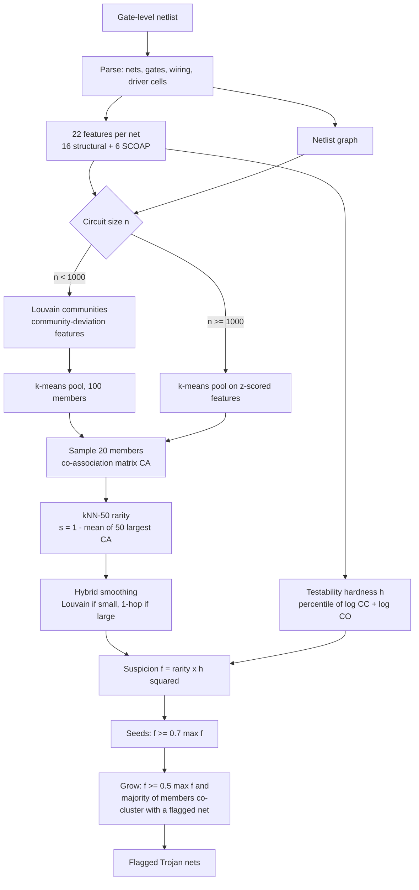

# TW-CA-kNN: Testability-Weighted Co-Association kNN for Unsupervised Hardware-Trojan Detection

TW-CA-kNN finds hardware-Trojan nets in gate-level netlists **without any labels**. It combines two signals:

- **Rarity.** An ensemble of k-means clusterings is turned into a co-association matrix. A net is rare when it seldom shares a cluster with its 50 closest matches. The score is smoothed over the netlist structure: Louvain communities for small circuits, directly wired nets for large ones.
- **Testability.** Trojan nets tend to be hard to control and hard to observe. Each net's SCOAP controllability and observability set a one-sided weight, so only *hard-to-test* rarity raises suspicion.

The number of nets to flag is chosen per circuit from the ensemble itself, with no contamination rate to set.

Developed as a capstone project at the Department of Electronics and Communication Engineering, PES University, Bengaluru.

## Results

15 Trust-Hub circuits (RS232, s1423, s15850, s35932, s38417), mean of 20 runs per circuit. All numbers are in percent.

| Method | TPR | TNR | Precision | Accuracy | F | AUC | AP | P@n |
|---|---|---|---|---|---|---|---|---|
| **TW-CA-kNN (automatic flag count)** | **90.0** | **99.2** | **87.2** | **99.2** | **85.1** | 97.7 | **92.7** | **90.1** |
| TW-CA-kNN (top C·n) | 87.6 | 98.5 | 67.7 | 98.4 | 71.7 | 97.7 | 92.7 | 90.1 |
| CA kNN-50 hybrid (top C·n) | 84.8 | 98.6 | 67.0 | 98.4 | 70.4 | **99.3** | 85.3 | 79.8 |
| Testability only (top C·n) | 79.4 | 98.3 | 62.0 | 97.9 | 65.2 | 96.8 | 87.9 | 81.5 |
| LOF + CBLOF stacking [1] (top C·n) | 74.2 | 98.1 | 58.2 | 97.6 | 61.0 | 98.3 | 69.9 | 63.0 |

- **P@n** is precision when exactly as many nets are flagged as there are Trojan nets.
- **C·n** is the fixed alarm budget of [1]: C = 0.05 for RS232, 0.1 for s1423 and 0.005 for the s-series.
- **Significance:** TW-CA-kNN beats every baseline on AP, P@n and F (paired Wilcoxon over the 15 circuits, p ≤ 0.016). See `results/tw_caknn/significance.csv`.
- **Other detectors:** `results/benchmark/` compares ten more unsupervised detectors (Isolation Forest, LOF, kNN distance, HBOS, ECOD, COPOD, OCSVM, PCA, CBLOF, LODA), an autoencoder, and graph-embedding variants. CA kNN-50 is the strongest rarity engine among them.

<details>
<summary>Per-circuit results (TW-CA-kNN, automatic flag count)</summary>

| Circuit | Nets | Trojan nets | TPR | Precision | F | P@n |
|---|---|---|---|---|---|---|
| RS232-T1000 | 283 | 11 | 90.9 | 75.7 | 82.3 | 86.8 |
| RS232-T1100 | 285 | 12 | 91.7 | 81.3 | 85.7 | 90.4 |
| RS232-T1200 | 288 | 13 | 100.0 | 81.2 | 89.3 | 87.3 |
| RS232-T1300 | 280 | 7 | 100.0 | 85.5 | 91.1 | 99.3 |
| RS232-T1400 | 284 | 12 | 100.0 | 83.8 | 90.7 | 91.2 |
| RS232-T1500 | 286 | 12 | 91.7 | 80.0 | 85.0 | 90.8 |
| RS232-T1600 | 280 | 7 | 100.0 | 49.1 | 63.8 | 96.4 |
| s1423_T401 | 576 | 37 | 99.5 | 81.5 | 89.6 | 86.6 |
| s1423_T402 | 556 | 17 | 100.0 | 89.5 | 94.4 | 93.5 |
| s15850-T100 | 2196 | 27 | 88.9 | 100.0 | 94.1 | 86.7 |
| s35932-T100 | 5863 | 15 | 86.7 | 100.0 | 92.9 | 88.3 |
| s35932-T200 | 5860 | 12 | 15.4 | 100.0 | 25.3 | 64.6 |
| s35932-T300 | 5884 | 36 | 97.2 | 100.0 | 98.6 | 100.0 |
| s38417-T100 | 5474 | 12 | 89.2 | 100.0 | 94.2 | 91.7 |
| s38417-T300 | 5506 | 44 | 98.6 | 100.0 | 99.3 | 98.4 |

</details>

## Method



1. **Features.** 16 structural features [1] (fan-in at 1–5 levels, reconvergent loops, distances to the nearest primary input/output, flip-flop and multiplexer, gate counts) plus the 6 SCOAP measures CC0, CC1, CO, SC0, SC1 and SO, capped at 1000.
2. **Clustering ensemble.** A pool of 100 k-means runs with K drawn uniformly from [2, √n]. Small circuits (n < 1000) are clustered on community-deviation features: each feature alongside its deviation from the mean of the net's Louvain community. Each run samples 20 members and builds the co-association matrix CA = HHᵀ / 20.
3. **kNN-50 rarity.** sᵢ = 1 − (mean of the 50 largest CA(i, j), j ≠ i). k = 50 is larger than a typical Trojan, so Trojan nets cannot vouch for each other.
4. **Hybrid smoothing.** s̃ = 0.5 s + 0.5 × (mean s of the net's Louvain community) for small circuits, or of its directly wired nets for large circuits.
5. **Testability weight.** h = percentile of log(1 + CC) + log(1 + CO) within the circuit, where CC = √(CC0² + CC1²). The suspicion score is f = s̃ · h².
6. **Automatic flag count.** Seeds are nets with f ≥ 0.7 · max f. Repeatedly add nets with f ≥ 0.5 · max f that a majority of the ensemble members cluster with an already-flagged net (CA ≥ 0.5).

| Parameter | Value |
|---|---|
| Pool / members per run | 100 k-means, K ~ U[2, √n] / 20 |
| Neighbours k | 50 |
| Smoothing weight | 0.5 |
| Size threshold (Louvain vs 1-hop) | 1000 nets |
| Testability exponent β | 2 |
| Seed / growth fractions | 0.7 / 0.5 of max f |
| Co-association majority | 0.5 |
| Runs per circuit | 20 |

## Repository layout

```
data/
  structural_features.csv     circuit, net, label, f0..f55
  testability_features.csv    circuit, net, label, CC0, CC1, CO, SC0, SC1, SO
  net_edges.csv               netlist wiring between scored nets (clock pins included)
  net_driver_cells.csv        cell type driving each net
src/
  tw_caknn.py                 TW-CA-kNN and its evaluation (main entry point)
  fs_experiment.py            k-means pool, co-association, kNN score, metrics, feature selectors
  hybrid_experiment.py        community features, Louvain / 1-hop smoothing
  dra_louvain.py              directed, gate-weighted Louvain communities
  benchmark_all.py            comparison with classical / feature-extraction detectors
  fs_select_compare.py        label-free feature-selection study
  ht_features.py              netlist parser, 56 structural features, SCOAP, labels
  export_graph.py             builds net_edges.csv and net_driver_cells.csv from netlists
results/
  tw_caknn/                   main results, per circuit, significance tests
  benchmark/                  all detectors, all metrics
  feature_selection/          label-free feature-selection study
```

## Reproducing the results

```bash
pip install -r requirements.txt

python src/tw_caknn.py data results/tw_caknn                     # main results, ~1.5 min on 2 cores
python src/benchmark_all.py data results/benchmark               # all detectors, ~5 min
python src/fs_select_compare.py data results/feature_selection   # feature-selection study, ~30 min
```

An optional third argument sets the number of parallel jobs (default: all cores). Seeds are fixed, so results are deterministic.

### Rebuilding the data from the netlists

The Trust-Hub netlists are not redistributed here. Download them from [trust-hub.org](https://trust-hub.org): the RS232 and s-series TjIn/TjFree benchmarks, and the TRIT-TS s1423 circuits [3]. Then run:

```bash
python src/ht_features.py  /path/to/netlists data 1000   # features, SCOAP (cap 1000), labels
python src/export_graph.py /path/to/netlists data        # wiring and driver cells
```

This reproduces the CSVs in `data/` exactly. Labels come from the Trust-Hub documentation: Trojan instances listed in the RS232 readme and the TRIT log, and nets absent from the Trojan-free version for the s-series.

## Notes and limitations

- **Labels** are used only to score results, never by the detector.
- **The 22 features** are the set selected in [1], where the selection used labels. With features chosen without labels (principal feature analysis, see `results/feature_selection/`), the fully label-free pipeline reaches 82.9 F.
- **Parameter choice:** β and the seed/growth fractions were set on these 15 circuits. The flag count is the most sensitive part.
- **s35932-T200** stays hard (F 25.3): most of its Trojan nets are neither rare nor hard to test.

## References

1. Nie et al., "Stacking ensemble feature-attention LOFs for detecting hardware Trojan," *The Journal of Supercomputing*, 2025.
2. L. H. Goldstein, "Controllability/observability analysis of digital circuits," *IEEE Trans. Circuits and Systems*, 1979.
3. J. Cruz, Y. Huang, P. Mishra, S. Bhunia, "An automated configurable Trojan insertion framework for dynamic trust benchmarks," *DATE*, 2018.
4. Trust-Hub benchmark suite, https://trust-hub.org

## Citation

A paper describing this work is in preparation. Please cite this repository until it is published.
